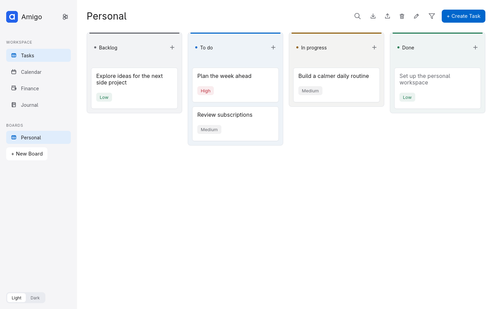
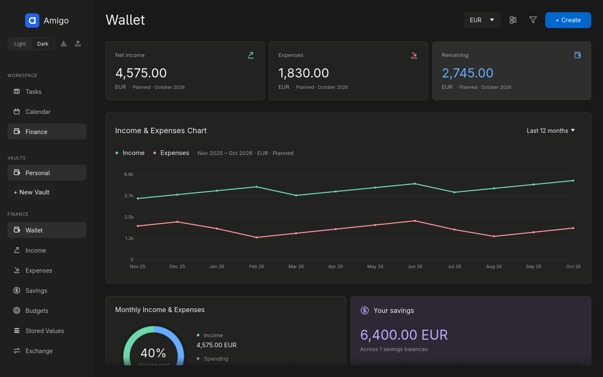

# Amigo


Amigo is a native Rust desktop workspace for personal tasks, calendars, and finances.
It stores your data locally and provides three areas:

- **Tasks:** multiple Kanban boards, custom statuses and categories, due dates, and attachments.
- **Calendar:** personal events and tasks, recurring items, iCalendar URL subscriptions, and Telegram reminders.
- **Finance:** income, expenses, savings, budgets, exchange rates, and optional encrypted vaults.

Personal boards, events, and finance records work offline. Calendar subscriptions,
Telegram reminders, and exchange-rate refreshes use network services when configured.
Amigo was formerly named Clerk; the Finance area preserves the Finscreen v2 JSON
model and calculation rules.

**Author:** [0x626f](https://github.com/0x626f). **License:** [GPL-3.0-or-later](LICENSE). **Build targets:** Linux, macOS, and Windows (x86_64 and ARM64).

[Run](#run) · [Build and package](#distribution-recipes) · [Tasks](#tasks) ·
[Calendar](#calendar) · [Finance](#finance) · [Backups](#import-export-and-deletion) ·
[Storage](#user-folder-storage) · [Development](#development) · [License](#license)

The [brand assets](docs/brand/README.md) include scalable logos, light/dark wordmarks, and a high-resolution app icon. The same artwork is included in the sidebar, native window, and platform packages.

The UI uses [egui and eframe](https://github.com/emilk/egui) 0.36: immediate-mode Rust widgets, with no JavaScript frontend or web server. Linux supports Wayland and X11. The [native CI workflow](.github/workflows/ci.yml) defines builds, tests, and packages for all three operating systems on x86_64 and ARM64. Native macOS/Windows execution still needs verification on those runners and desktop systems.

[Dark Tasks preview](docs/tasks-dark.png) · [Dark Finance preview](docs/finance-dark.png)

Screenshots use synthetic data and show the current native interface in light,
dark, and compact layouts.

## Run

Install a current stable Rust toolchain and the platform's native build tools:

| Platform | Build tools | Runtime / package baseline |
| --- | --- | --- |
| Linux | C/C++ compiler and linker; your distribution's graphics development libraries | Desktop session with OpenGL, Wayland or X11; glibc minimum depends on the build host |
| macOS | Xcode Command Line Tools (`xcode-select --install`) | Package recipes default to macOS 12+; x86_64 and Apple Silicon builds are separate |
| Windows | Visual Studio Build Tools with Desktop development with C++, the Windows SDK, and the native MSVC Rust toolchain | Windows 10+ and OpenGL-capable graphics drivers |

From the repository root:

```sh
cargo run --locked
```

Build the optimized executable with `just build` (or the Python command below).
Run `target/release/amigo` on Linux/macOS, or `target\release\amigo.exe` on Windows.
Windows MSVC builds statically link the C runtime and launch without a console window.

For a direct Cargo build on Linux/Windows:

```sh
cargo build --release --locked
```

On macOS, the build recipe supplies `MACOSX_DEPLOYMENT_TARGET=12.0` unless you
already set it. The packager reads the executable's deployment target into the
app bundle and release metadata.

Standalone Linux launches register the Amigo logo and a user desktop launcher when no Amigo desktop entry is installed, so Wayland window menus can resolve the app icon. Packaged installations retain their packaged launcher.

A desktop session and OpenGL support are required. Linux file dialogs use
`xdg-desktop-portal` with your desktop's portal backend; opening attachments also
requires `xdg-utils`. Your distribution may require development packages for the
native graphics libraries when building from source.

Data saves automatically in `~/.amigo/` on Linux/macOS or `%USERPROFILE%\.amigo\` on Windows. Use `AMIGO_HOME` to select a different
library; see [User-folder storage](#user-folder-storage) for the layout and migration
options. The first build downloads dependencies; later builds can use `--offline`
when those dependencies are cached.

All Tasks, Calendar, and unlocked Finance screens preload together at startup behind one loading indicator. Screen layouts are prepared in the background and fonts are prepared in small steps, so the sidebar stays responsive. Switching tabs after startup opens prepared screens immediately. Opening another board or vault, unlocking a vault, or changing the display scale prepares the updated workspace again. Development builds optimize dependencies while keeping application code debuggable.

## Just recipes

Install Python 3.11+ and [just](https://just.systems/man/en/), then run `just` to
list the recipes. The recipes pass arguments directly to Python; Bash and
PowerShell are not required. Ensure `python3` is on PATH on Linux/macOS and
`python` is on PATH on Windows.

```sh
just run                 # Development build and launch
just run-release         # Optimized build and launch
just build               # Optimized native binary
just test                # All regular workspace tests
just test-optional       # Ignored tests; requires Node.js and network access
just fmt                 # Apply Rust formatting
just check               # Formatting, Clippy, workspace tests, release helper tests
```

Extra test arguments are forwarded, for example `just test -- --nocapture`.
Application arguments are forwarded by `just run`. Every recipe also works
without just: use `python3 -B scripts/dev.py COMMAND [ARGS...]` on Linux/macOS,
or `python -B scripts/dev.py COMMAND [ARGS...]` on Windows. For example:

```powershell
python -B scripts/dev.py check
python -B scripts/dev.py package-windows
```

### Distribution recipes

Packages are built **on the target operating system**, with a native x86_64 or
ARM64 Rust toolchain. Build macOS packages on a Mac and Windows packages on Windows.
`just dist` selects all formats for the current OS and builds the application once.
Individual package recipes build it too; setting `CARGO_BUILD_TARGET` is rejected
for native packaging, and executable headers are checked before staging.

| Platform | Recipe | Output | Additional tools |
| --- | --- | --- | --- |
| Linux | `just package-rpm` | RPM | `rpmbuild` |
| Linux | `just package-deb` | DEB | `dpkg-deb` |
| Linux | `just package-appimage` | AppImage | [linuxdeploy](https://github.com/linuxdeploy/linuxdeploy/releases) with its AppImage output plugin |
| macOS | `just package-macos` | ZIP containing `Amigo.app` | Built-in `ditto` and `codesign` |
| macOS | `just package-dmg` | Drag-to-install DMG | Built-in `hdiutil` and `codesign` |
| Windows | `just package-windows` | Portable ZIP containing `Amigo/amigo.exe` | Python standard library |
| Windows | `just package-installer` | Per-user setup EXE and uninstaller | [Inno Setup](https://jrsoftware.org/isinfo.php) 6.3+ (`ISCC.exe`) |

Linux packaging also needs binutils (`readelf`, `strip`) and
`desktop-file-utils`. Install the native X11, Wayland, xkbcommon, and D-Bus runtime
libraries. These can be loaded dynamically, so the AppImage recipe includes them
explicitly, except for Wayland. The destination provides its own Wayland libraries
to stay compatible with its graphics drivers. The official linuxdeploy AppImage
can be installed as `linuxdeploy` on PATH; `APPIMAGE_EXTRACT_AND_RUN=1` avoids
requiring FUSE during packaging.
The destination still needs its own OpenGL/EGL drivers.

Linux packages include AppStream metadata with the display name **Amigo**,
developer **0x626f**, project license **GPL-3.0-or-later**, screenshots, and project
links. RPM headers also identify **0x626f** as the vendor and packager. The
AppStream metadata document uses the FSFAP license for software-catalogue reuse.

Discover's direct RPM-file preview uses the filename as its title and can show
**Unknown author** independently of the package's AppStream metadata. If its
button stays on **Loading…**, close Discover and reopen the file after pending
system package operations finish, or install with Fedora's package manager:

```sh
sudo dnf install ./amigo-0.0.1-linux-x86_64.rpm
```

To inspect the package without installing it:

```sh
rpm -qp --queryformat 'Name: %{NAME}\nLicense: %{LICENSE}\nPackager: %{PACKAGER}\nVendor: %{VENDOR}\n' ./amigo-0.0.1-linux-x86_64.rpm
pkcon get-details-local ./amigo-0.0.1-linux-x86_64.rpm
```

The license expression defaults to `[workspace.package].license` in `Cargo.toml`
and the full text defaults to the repository's [LICENSE](LICENSE). `AMIGO_LICENSE`
and `AMIGO_LICENSE_FILE` remain available as explicit overrides. DEB packages
also require a maintainer:

```sh
# Linux: required for package-deb and dist.
export AMIGO_MAINTAINER='Your Name <you@example.com>'
just dist-check          # Check tools and metadata for this OS
just dist-check deb      # Check one native format
just dist                # Build every format for this OS
```

On macOS or Windows, run `just dist-check` and `just dist` without the Linux
maintainer variable. Inno Setup is found on PATH or in its standard installation
folders. Windows installs to the current user's Programs folder without elevation;
uninstalling the application preserves the user's Amigo library.

Output goes to `dist/<version>/<platform>/<architecture>/`, for example:

```text
dist/0.0.1/linux/x86_64/amigo-0.0.1-linux-x86_64.deb
dist/0.0.1/macos/aarch64/amigo-0.0.1-macos-aarch64.app.zip
dist/0.0.1/macos/aarch64/amigo-0.0.1-macos-aarch64.dmg
dist/0.0.1/windows/x86_64/amigo-0.0.1-windows-x86_64.zip
dist/0.0.1/windows/x86_64/amigo-0.0.1-windows-x86_64.setup.exe
```

All formats include the executable, platform icon, README, application license,
and the bundled font, country-catalogue, and Unicode license notices. macOS keeps
these documents in `Amigo.app/Contents/Resources/docs`; Windows keeps them in
`Amigo/docs`; Linux uses `/usr/share/doc/amigo/`. Staging uses temporary directories
and an explicit file list; personal libraries are never included.

Build Linux packages on the **oldest distribution you intend to support**; an
AppImage does not lower the executable's glibc requirement. DEB dependencies and
release notes record that requirement. macOS packages use an ad-hoc signature by
default, suitable for development. Set `AMIGO_MACOS_SIGN_IDENTITY` to a Developer ID
Application identity for distribution signing; notarization is a separate step
requiring your Apple developer credentials. Windows packages are unsigned unless
you sign the executable/installer separately. Test downloaded packages on their
intended desktop systems before publishing.

### Prepare a GitHub release

Commit and push the source to `origin` first. With GitHub CLI authenticated,
prepare each platform on its native build machine:

```sh
just release-prepare
# Review packages and edit dist/0.0.1/<platform>/<architecture>/RELEASE_NOTES.md.
git tag -a v0.0.1 -m 'Amigo 0.0.1'
git push origin v0.0.1
just release-draft v0.0.1
```

Create and push the tag once, then fetch it on the other build machines.
`release-prepare` runs the checks, builds native packages, and writes
`SHA256SUMS-<platform>-<architecture>`, `SOURCE-<platform>-<architecture>.json`, and
editable `RELEASE_NOTES.md`. Source information records the commit, clean state,
version, platform, architecture, and platform-specific runtime requirement.
Preparation only writes local files and preserves edited notes. If the source is
dirty, commit it and prepare again before uploading.

`release-draft` verifies checksums, source state, and the local and remote tag.
It creates an unpublished draft or adds another platform's assets to the existing
draft. Asset names include platform and architecture, preventing cross-platform
collisions. It refuses published releases and never overwrites existing assets,
creates tags, pushes commits, or publishes the release. Review the combined draft
on GitHub before publishing it. The [CI workflow](.github/workflows/ci.yml) also
builds packages and uploads workflow artifacts; it does not create releases.

## Appearance and settings

The interface follows Apple-inspired macOS conventions: borderless buttons, rounded controls, blue primary actions, restrained hover/press feedback, and a quiet sidebar. Text inputs use soft surfaces, while keyboard focus remains visible. Dialogs keep clear headings, grouped fields, readable labels, and fixed Save/Cancel actions. Use **Light / Dark** below the Amigo logo; the saved appearance transitions smoothly without rebuilding the font atlas. Shared egui helpers keep all three tabs consistent. Adwaita Sans is bundled under the SIL Open Font License; see `crates/ui/assets/fonts/LICENSE`. The project includes an MIT-licensed [Apple design skill](skills/apple-design/SKILL.md) with upstream attribution and Amigo-specific guidance.

Each tab owns its settings. **Calendar → Settings** contains calendar URL subscriptions, a configurable refresh interval (60 seconds by default) and Telegram notifications. **Finance → Settings** contains **Exchange → Refresh Every** (60 seconds by default), saved in `~/.amigo/library.json`. Rates refresh for the open, unlocked vault and keep their previous values if a provider fails. Periodic directory polling is disabled; confirmed changes still autosave.

App status messages appear as compact popups at the bottom right. Their width follows the content, with longer text wrapping up to four lines and the full message available on hover. Up to three notifications stack upward and fade out after five seconds; the close icon dismisses one immediately. Success and error notifications use distinct icons and colors without shifting the page content.

## Tasks

- Multiple named boards, each stored in its own folder with one Markdown file per task. Create and switch boards from the sidebar.
- Configurable Kanban columns, starting with Backlog, To do, In progress, and Done.
- Add, rename, reorder, color, and delete statuses. Mark any status as Completed to give its cards a completed appearance.
- Click or tap a card to open its task dialog. To move it with a touchpad, tap once, then tap again and hold while sliding your finger; lift to drop. Mouse double-click-and-drag and ordinary click-and-drag also work. Columns grow with their tasks, and the whole board scrolls vertically without a visible scrollbar. Cards sort High → Medium → Low; old Normal priorities become Medium. Drag tasks between statuses or reorder tasks within the same priority. A horizontal line shows the actual destination in the target column, respecting priority order. Single-click opening waits for the system double-click interval; movement past the click threshold starts a drag, and Escape cancels it. Hovering cards keeps the normal arrow cursor.
- Create and edit titles, descriptions, statuses, categories, priorities, and optional due dates.
- Search by title, description, or category. Use the funnel icon beside **Create Task** to open checkbox filters. Select multiple categories and priorities; options within a group match any selected value, while categories, priorities, and search combine. Leaving a group unchecked includes every value. The menu stays open while selecting; **Clear Filters** resets all filters and search. Long lists scroll without scrollbars.
- Tasks created with exactly one category selected inherit that category.
- Task cards and dialogs show task titles without internal IDs. The trash icon in an existing task's dialog opens a separate deletion confirmation. Cancel, Close, or Escape returns to the draft; Delete Task confirms removal. Changes save locally.

Click the **Board Settings** sliders icon above the Kanban to open a configuration dialog and edit **Statuses** and **Categories**, then choose **Save Board**. Cancel discards configuration changes. Click the name-edit icon before Close to edit only the board name in the title; the name field receives focus automatically, and Save Board commits the rename. Drag the grip beside a status to reorder it; an insertion line shows the drop position. The arrow buttons offer an alternative. Changes remain a draft until Save Board; Cancel discards them. Kanban columns follow the saved status order. Renaming statuses or categories preserves task assignments. Deleting a used status requires choosing a replacement; deleting a category makes its tasks Uncategorized and keeps the tasks.

The right-aligned toolbar above the board contains **Search → Board settings → Filters → Create task**. Clicking Search expands and focuses its input; focus loss or Escape collapses it. The icon and field crossfade during the 220 ms size transition, and reversing direction continues from the current width. The query stays active, and a dot marks the search icon until the query is cleared. Buttons, including the search, filter, settings, and column plus icons, animate on hover.

Existing Amigo workspace files are migrated automatically into a Personal board and Personal vault. Older numeric task statuses are converted to stable IDs. Board statuses, categories, task ordering, and task metadata are preserved.

Task dialogs put summary and description beside the task properties. Due dates support keyboard entry or a calendar with month navigation, Today, and Clear Date. Freeform task labels are no longer shown or editable; existing label data is preserved in saved files. The Tasks sidebar shows the board list without Board Overview. Save and Cancel stay outside the scrolling body. Close and Escape discard the draft, while clicks outside the modal preserve it and cannot change the board. Board configuration keeps Add status / Add category visible below the scrolling list.

Status columns have tinted surfaces, colored accents and headers, separated cards, and clear spacing inspired by Jira. These are personal boards; they do not connect to Jira.

Open a task and use the **+** icon immediately after **Attachments** (hover for **Attach Files**), or drop files onto its dialog. Files of any type are copied into the board’s attachment folder when you save the task; large copies run in the background. Cancel discards pending files, and failed multi-file imports roll back their copies. Attachment metadata lives in the task’s Markdown front matter. Removing an attachment and saving removes its managed copy when the board is saved, while the original source file is untouched.

Click an attached filename to open the copied file through the system association. **Open With…** lets you select an executable application, including when no default association exists. Common document, image, spreadsheet, archive, code, and media types have colored file icons. On Linux, native file selection uses the desktop portal; install `xdg-desktop-portal` with your desktop’s backend and `xdg-utils`. AppImages use the host desktop’s portal service.

macOS also accepts `.app` bundles in **Open With…**. Windows uses the native file
association through its built-in PowerShell launcher; document paths are passed
as data, including filenames containing spaces or shell characters.



[Board settings preview](docs/board-settings.png) · [Checkbox filter menu](docs/task-filters.png)

[Task attachments](docs/task-attachments-dark.png)

## Calendar

Calendar opens in **Day** view. Its view selector is ordered **Day → Week → Month → Agenda**, with personal events/tasks,
repetition and read-only iCalendar URL subscriptions.
Calendar settings contains URL subscriptions, refresh timing, and Telegram
configuration. Telegram can send reminders before scheduled items and a catch-up
summary when Amigo starts again. Mouse-wheel and touchpad scrolling work without
visible scrollbars; the toolbar stays in place. Overflowing all-day events scroll
separately in week/day views.

See the [Calendar URLs and Telegram guide](docs/calendar.md) for setup and storage details.

[Calendar settings](docs/calendar-url-settings.png) · [Calendar preview](docs/calendar-light.png) · [Compact dark Calendar](docs/calendar-dark-compact.png)

## Finance

- **Wallet:** income, expenses, and remaining balance for one selected month, defaulting to the current month. Its Date selection is independent of the Income/Expenses filters. Planned mode includes all records in that month; Actual includes received income, automatically applicable regular expenses, and manual expenses previously marked for inclusion. Savings retain their full balance across months, excluding entries marked Deduct. The Income & Expenses Chart defaults to the last 12 calendar months, including the current month. Extend it to 24, 36, or 60 months, All history, or choose Custom range with inclusive From and To dates. Partial months include only records dated within the range; regular expenses use their monthly occurrence date. Hover a month for income, expenses, and net totals in the reporting currency. Recurring expenses appear in each applicable month. The chart range is independent of the Date filter on summary cards; the Planned / Actual setting applies to both.
- **Income:** gross/net amounts, separate reported net/gross values using saved dated exchange rates, percentage tax and withdrawal fees, account/platform, source/company, tax country, received state, monthly filtering and copying a month's income to the next month. Table headings share one font size per layout (16 px normally, 14 px in compact windows), with centered captions and short wrapped labels where needed.
- **Expenses:** **Regular** defines recurring costs with a **From** date; **Monthly** shows expenses grouped by calendar month under **Date**, combining manual entries with one automatic occurrence of each applicable regular expense. A regular expense applies from its From month onward, including Actual totals, without a Use toggle. Automatic monthly rows are read-only; edit their source in Regular. Removing a regular expense preserves the current and previous months and stops automatic inclusion from the next calendar month. The cancel icon before Remove excludes an expense from the current month onward while preserving earlier months. Cancelled records remain available in their expense group with a disabled cancel icon; hover it to see the cancellation date. Manual entries apply only to their Date month. **+ Expense** creates a record in the selected group. Both tables show Title, From/Date, Amount, Currency, Category, Priority, and Reported; Labels, Use, and Through are not displayed. Saved legacy labels are preserved. Categories are selected from a dropdown; typing a new category into a record cannot create one.
- **Savings:** account balances, currencies, configured categories, expandable comments, ordering, and exclusion from the balance using the original Deduct flag.
- **Budgets:** trip or project budgets with a free-form Label, Allowance, Currency, Spent, and Remaining. Each budget row has an expense-list dropdown and a **+** button. Lists start collapsed; the dropdown shows or hides that budget’s expense subrows (Label, Amount, Currency, Comment, and Paid). The row’s **+** button adds an expense and expands its list. Save or cancel the budget row to apply or discard its expense edits. Spending converts each item into the budget currency using its saved creation-date rate. Missing rates show Pending FX instead of an incomplete total. Only expenses marked **Paid** count toward Spent, Remaining, Wallet spending, and its history chart, in both Planned and Actual mode. Paid defaults to unchecked, including for older entries without a saved paid status; save the budget row to apply checkbox changes.
- **Stored values:** currencies, blockchain/token mappings, chains and RPC URLs, categories, clients, accounts, countries, expense labels, and separate savings categories. Linked records follow renames. Values in use cannot be deleted until their references are removed.
- **Exchange:** choose Base and Quote currencies, view their exchange rate, and swap the pair. Refresh Rates retrieves dated fiat and cryptocurrency prices from the [Currency API](https://github.com/fawazahmed0/exchange-api), alongside automatic refresh. Failed lookups preserve existing rates.
- Multiple named finance vaults with optional encryption. Plain vaults open immediately; encrypted vaults ask for their password when opened.

The settings icon in **Expenses** or **Savings** opens that view’s category settings. Add or rename categories there; a category in use must be reassigned before removal. Category IDs preserve assignments through renames. **Vault Settings…** opens the shared vault configuration and preserves your category draft when you return. In other finance views, the settings icon opens **Vault Settings** directly. The title shows the vault name, with a name-edit icon before Close. Clicking the icon edits only the vault name in the title and focuses its text field; Save Settings commits the rename. Reporting currency is always enabled, defaults to EUR, and is selected from the Wallet toolbar immediately before Settings. **Save Settings** applies the changes; **Cancel** discards them. Security provides encryption for plain vaults and Lock Vault plus Change Password for encrypted vaults. Changing a password requires the current password, a new password, and confirmation.

Currency conversion is always enabled. Every income, expense, saving, budget, and budget expense stores its creation timestamp and exchange snapshots in its metadata. Snapshots include USD and EUR, the reporting currency, and the parent budget currency for budget items. New records use the creation date, independently of editable transaction or due dates. Copying income creates a fresh timestamp and snapshots.

Rates are quote units per source unit; the shared rate cache remains USD per one source unit. Snapshot values are retained after later refreshes and settings changes. Cryptocurrency snapshots use observed prices, including stablecoin prices when available. Unavailable historical prices remain pending and retry in the background during exchange sync, in batches of four dates. Refresh Rates also requests pending snapshots. Same-currency conversion is always 1. Missing conversions are flagged and excluded from Wallet totals; a budget with a missing conversion shows no partial Spent or Remaining total.

Older files lack creation timestamps. Their transaction date (budget month for old budgets, migration day when no date exists) initializes an explicitly marked inferred timestamp. Existing approximate conversion behavior remains available for these legacy records while exact snapshots are pending. Legacy savings labels initialize savings categories; original label metadata is retained. Existing budget labels and allowances are preserved, with the former reporting currency used as their currency. Old monthly label-linked spending is replaced by explicit nested expenses; existing standalone expenses are retained.

Press **Enter** to confirm the active dialog or save all pending finance rows, including edits in other finance views. Valid rows are saved; rows with validation errors stay open for correction. Clicking a row's checkmark saves that row only. **Esc** discards the active edit. In task descriptions, Enter inserts a newline; **Ctrl+Enter** (Command+Enter on macOS) saves the task. An open dropdown or calendar handles Esc before the edit underneath. Esc cancels a deletion prompt first; Enter confirms only that deletion. Search and filter menus accept with Enter and restore their previous values with Esc.

Income, expenses, savings, budgets, chains, and other stored values are edited directly in table cells. The create button adds an editable row and focuses its first input. Use the row's checkmark to save or its cross to cancel; invalid entries stay in the row with an error. Multiple unfinished rows are supported, and new rows stay visible under active search and filters. Delete requires an inline confirmation. Currencies use a dedicated details dialog; vault settings uses its configuration dialog.

Tables use consistent, borderless cell surfaces, alternating row shading, and a shared hover highlight. Income is grouped newest-first under month-and-year separators such as **April 2025** and **June 2026**. Flat lists keep column headings above their scrolling rows and render only visible rows, retaining the active editor when it scrolls offscreen. At narrow window sizes, scroll horizontally with a touchpad or Shift + mouse wheel to keep columns readable; row actions stay pinned on the right. Scrollbars remain hidden. Wallet sections and expanded budgets retain their page scrolling.

Record autosaves run on a background worker so disk writes do not block tab navigation. Edits made during a save remain queued for the following save; failed saves retain edits for retry. Board/vault switches, locking, encryption, and application exit wait for pending saves before changing the storage context.

[Inline finance preview](docs/finance-inline.png) · [Compact dark preview](docs/finance-inline-dark.png)

[Category settings](docs/expense-settings-dark.png) · [Nested budgets](docs/budgets-nested-dark.png) · [Expanded comment editor](docs/comment-editor-dark.png)

Manage accounts under **Stored Values → Accounts**, with a single **Label** property. Create, rename, search, and delete accounts there. Existing Income/Savings account IDs remain linked, and renames update their displayed names. Accounts in use must be reassigned before deletion. Country, Principal, and Comment are no longer account properties. Accounts save with the vault, including encrypted vaults.

[Stored account labels](docs/accounts-dark.png)

[Currency symbols](docs/currencies-dark.png) · [Token details](docs/currency-details-dark.png) · [Exchange](docs/exchange-dark.png) · [Date filter](docs/finance-filters-dark.png) · [Centered values](docs/finance-table-dark.png) · [Country dropdown](docs/country-picker-dark.png)

Click a **Comment** cell in Savings or a budget expense to read and edit the full text in a large multiline popup. Enter adds a line; **Ctrl+Enter** applies the comment, and **Esc** cancels it. Apply Comment updates the pending row; save the row or press Enter after closing the popup to persist it. Clicking outside the popup discards its comment draft.

Dates use `YYYY-MM-DD`. Existing unpadded dates are normalized, and date filters display full names such as **September 2026** in chronological order. Saved dated rows show newest first, with undated rows last; unfinished drafts stay at the top while editing. Amounts accept a decimal point. Currency cells are dropdowns containing the vault’s available currencies, including chain and token details for entries that share a code. Stored Values → Currencies shows a single **Symbol** column. Click a symbol or **+ Currency** to open details. Enable **Crypto Token** to require a chain and token address; disabling it clears the token mapping when saved. Add chain definitions under Stored Values → Chains. Fresh vaults include EUR, USD, UAH, USDC (Ethereum Mainnet), USDT (Ethereum Mainnet), USDT (Tron), and native ETH (Ethereum Mainnet). Older vaults receive missing defaults once; custom entries and linked IDs are preserved. Native ETH keeps its network without requiring a token contract. The symbol list includes network names to distinguish USDT variants. Date cells have a calendar picker. Other typed reference values are remembered when you save a row. Tax Country uses a searchable dropdown restricted to the bundled ISO country/territory catalogue. Browse the read-only list under Stored Values → Countries. Computed net amounts, conversions, spending, and remaining amounts stay read-only and are centered beneath their headers. Date values and editable numeric/text values are also centered. Currency and Country selections are centered with space reserved for their dropdown arrows; compact Country cells show ISO codes with full names on hover. Amounts that round to zero display `0.00`, including negative zero and floating-point remainders. Finance tables share responsive column widths so every column fits the window, including at the minimum size. Compact headers and icon actions leave more room for data; hover shortened headings or values to read them in full. Vertical scrolling remains available without scrollbars.

Finance uses the same **Search → Settings → Filters → Create** toolbar as Tasks. Search expands on click and collapses on blur. Income and Expenses open without a Date filter. Wallet starts on the current month and always uses a monthly period; it has no All dates option. Clear Filters restores these defaults and clears search and currency selections. The filter menu contains a Date selector and currency checkboxes where applicable; Wallet has Planned / Actual controls, while Stored Values has its reference-type selector. Income and expense tables use the same descending reported-amount order within each month (reported net for income). Search on record pages filters the current records; Wallet has no search field.



[Compact Wallet chart](docs/wallet-history-compact.png)

[Vault settings preview](docs/vault-settings.png) · [Finance filters](docs/finance-filters.png) · [Date picker](docs/date-picker.png)

## Import, export, and deletion

Board Settings, Vault Settings, and Calendar Settings contain **Import** and **Export** icons in their headers for portable `.amigo` files. Board and Vault headers place **Import → Export → Delete → Edit Name → Close** in that order. Hover an icon to see its action. Use **Browse…** to choose a file or enter its path. Board files include tasks, statuses, categories, ordering, and binary attachments. Vault files include every finance record and reference value; encrypted vaults retain their original encryption and password. Calendar files contain the Calendar collection, subscriptions, refresh settings, reminder receipts, and subscription URLs. Calendar import replaces that collection while preserving other connection settings.

An individual board or vault import adds the item and opens it. If its stable identity already exists in the destination, import replaces that matching item after confirmation. Other boards and vaults remain in place. Imports show a validated summary before the final action. Malformed files, damaged checksums, invalid paths, and incomplete attachments are rejected before live data changes.

The **Import Amigo Setup** and **Export Amigo Setup** icons sit immediately after the Light/Dark switcher in the sidebar. They open the native file chooser directly. A setup file contains the entire library, including all boards, vaults, attachments, Calendar data, appearance, selected items, and connection settings. After choosing an import file, **Replace All Data** replaces all existing library data with the reviewed backup. Export the current setup first to keep a copy. Setup and Calendar files include connection credentials, so store them privately. Vault passwords are still required after restoring encrypted vaults.

Board and Vault settings also offer **Delete Board…** and **Delete Vault…**, each with a separate confirmation dialog. Cancel or Escape preserves the item; Enter does not confirm destructive actions. Deleting a board removes its attachments too. Deleting the last board or vault creates an empty Personal replacement so Amigo remains usable. File work runs on a background worker with a loading indicator, and staged replacement retains recovery information until the new library is installed.

## User-folder storage

The default library is `~/.amigo` on Linux/macOS and `%USERPROFILE%\.amigo` on
Windows. An existing `HOME` environment override takes precedence on every OS;
Windows also supports `HOMEDRIVE` + `HOMEPATH` when `USERPROFILE` is unavailable.
The folder layout and `.amigo` exports are shared across platforms. Close Clerk before launching Amigo for the first time. An existing `~/.clerk` library (or the earlier `~/Clerk` folder) moves there automatically if the new folder does not already exist. The complete library moves together, including boards, vaults, attachments, calendar data, credential keys, and backups. An existing Amigo folder is never overwritten:

```text
~/.amigo/
  library.json                    # appearance, exchange refresh timing, selected board/vault IDs
  organizer.json                  # Calendar items, subscription metadata/cache, reminder receipts
  credentials.enc                 # encrypted subscription URLs and Telegram settings
  credentials.key                 # owner-only credential encryption key
  boards/<board-id>/
    board.json                    # board name, statuses, categories, task order
    <task-id>.md                  # one task per Markdown file
    attachments/<attachment-id>/<original-filename>
  vaults/<vault-id>/
    vault.json                    # vault name and encryption flag
    records/                      # plain vaults only
      references.json             # currencies, accounts, categories, other references
      income/<record-id>.md
      expenses/<record-id>.md
      savings/<record-id>.md
      accounts/<record-id>.md
      budgets/<record-id>.md
      fxRates/<record-id>.md
    vault.enc                     # encrypted vaults only; replaces records/
```

Folder IDs remain stable when a board or vault is renamed. Record filenames encode their IDs so imported IDs cannot be interpreted as paths. Markdown files use JSON front matter (also valid YAML), followed by a readable task heading and description. You can edit a task's heading, description, or front matter with a text editor; both LF and Windows CRLF line endings are accepted. Periodic directory reload is disabled for now. Restart Amigo to load external edits; avoid editing the same records externally while Amigo is open. Invalid files encountered during load are reported and preserved.

Use **+ New board** in Tasks or **+ New vault** in Finance. Each board has its own statuses and categories; each vault has its own finances and reference values. Changes save automatically. Switches save the current data before opening the next board or vault. Task boards and the selected finance vault are independent.

For an encrypted vault, select **Encrypt this vault** when creating it, or **Vault settings → Encrypt vault…** for an existing plain vault. Enter and confirm the password. Vault contents are encrypted using AES-256-GCM and a PBKDF2-SHA-256 key derived with a random salt and 600,000 iterations; each save uses a fresh random nonce. Password processing runs on a worker thread. The password is never saved, and the derived key stays in memory only while the vault is open. Wrong passwords or modified ciphertext leave the vault locked. Vault names remain visible in the sidebar and metadata.

[Encrypted vault prompt preview](docs/vault-password.png)

Use **Vault settings → Lock vault** to close an encrypted vault. Switching to another vault or closing the app also discards its key. Selecting that vault again requires its password. Encrypted vaults have no plaintext record files; their contents are decrypted in memory. Boards and plain vaults remain readable files.

On first launch without a folder library, an existing `$XDG_DATA_HOME/amigo/workspace.json` (or `~/.local/share/amigo/workspace.json`) is imported automatically; the older `clerk/workspace.json` location is also recognized. Amigo verifies the migrated tasks, board settings, and finance data by reading the new files before replacing the old workspace with a migration receipt. This avoids leaving an unencrypted legacy copy behind. Failed migrations preserve the source data.

Set `AMIGO_HOME` to choose another library location:

```sh
AMIGO_HOME=/path/to/amigo-library cargo run --locked
```

In Windows PowerShell:

```powershell
$env:AMIGO_HOME = "$env:USERPROFILE\AmigoLibrary"
cargo run --locked
```

Use `AMIGO_DATA_FILE` for migration and isolated previews; its library is stored beside it with the `.library` extension. The legacy `CLERK_HOME` and `CLERK_DATA_FILE` overrides still work, with explicit `AMIGO_*` overrides taking precedence. To back up your data, use the **Export Amigo Setup** icon beside the theme switcher, or close Amigo and copy the entire library folder. Keep the password for encrypted vaults; it cannot be recovered by the app. Library folders use owner-only permissions on Unix, and files are saved through temporary files and rename.

## Development

Run `just check` for formatting, Clippy, workspace tests, and release helper tests,
or run the checks individually (use `python` instead of `python3` on Windows):

```sh
cargo fmt --all --check
cargo test --workspace --locked
cargo clippy --workspace --locked --all-targets -- -D warnings
python3 -B -m unittest discover -s scripts -p 'test_*.py'
```

The [native CI workflow](.github/workflows/ci.yml) runs these checks, compiles the
preview examples, and creates packages on Linux, macOS, and Windows for x86_64 and
ARM64. Package-helper tests validate ZIP contents, app-bundle metadata, architecture
checks, and release integrity using synthetic files. Native desktop behavior and
OS trust/signing prompts still require platform testing.

The regular tests cover calculations, historical FX selection, recurrence, persistence, encryption, reference renames, custom statuses and reassignment, category filtering, Markdown editing, automatic migration, board/vault switching, encrypted vault locking and password prompts, and pointer-driven board settings, task editing, and drag-and-drop. Optional checks require Node.js (independent browser Web Crypto compatibility) and network access (live fiat rates):

```sh
cargo test --workspace --locked -- --ignored
```

Capture the main screens, inline finance rows, task form, board settings, and vault settings with synthetic data in a desktop session:

```sh
AMIGO_DATA_FILE=/tmp/amigo-preview/workspace.json \
  cargo run --locked --example preview -- /tmp/amigo-preview
```

Add `--structure-scenes` to preview category settings, Savings, expanded comments, nested budgets, and task attachments; combine with `--compact` or `--dark`. The preview requires a separate data path and exits after capturing PNGs. Its screenshots contain synthetic data.

Append `--dark` after the output directory to capture the dark appearance. Use `--filters`, `--finance-filters`, or `--date-picker` for a single screenshot with the corresponding popup open, `--finance-settings` to open Finance settings through its toolbar button, and `--compact` to preview the minimum 980 × 640 window size.

Append `--custom-board` to preview five statuses and sample task categories. Append `--library-scenes` to include multiple boards, vaults, and the encrypted-vault password prompt (synthetic data only).

Use `--wallet-chart` to capture the Wallet chart with 24 months of synthetic income and expenses. Use `--accounts` to capture the label-only account list in Stored Values.

Use `--finance-inline` to capture the expense table with an unfinished row and inline controls. Add `--finance-large` for 5,000 synthetic income rows to check table scrolling and density, or `--finance-months` for three rows per month to review month separators. Add `--profile` to print UI timings for the first three frames of each screen. Use `--finance-reference-scenes` for the currency symbol list, token details dialog, and Exchange pair view. Use `--finance-country-scenes` for the centered income table, country dropdown, and country catalogue.

Use `--search-motion` to click the real Search control and capture collapsed, intermediate, and expanded frames. Use `--theme-motion` to capture light, intermediate, and dark animation frames and log UI frame timings. PNG encoding runs on worker threads so capture does not pause the animation.

Use `--task-drag` to exercise a fast double-click-and-hold gesture in the native window. It batches click and movement events, verifies that the task stays in its original column while held, and checks the final drop before capturing `task-drag.png` and `task-drop.png`.

Use `--touchpad-drag` to replay the touchpad tap-and-drag event sequence: one synthesized primary-button hold, pointer movement, and release. It verifies the final drop and captures `touchpad-drag.png` and `touchpad-drop.png`.

Capture Calendar views and settings separately with isolated synthetic data:

```sh
AMIGO_DATA_FILE=/tmp/amigo-calendar-review/workspace.json \
  cargo run --locked --example organizer_preview -- /tmp/amigo-calendar-review/screens --dark --compact
```

The Calendar preview never downloads feeds or sends Telegram messages.

### Repository hygiene

Commit `Cargo.lock` with dependency changes so `--locked` builds use the same
resolved versions. The [.gitignore](.gitignore) excludes build and distribution
output, Python caches, local IDE settings, OS metadata, environment files, and
personal libraries and `.amigo` exports. Environment example files and shared
JetBrains run configurations in `.run/` remain versioned. Keep synthetic screenshots
and bundled assets under `docs/` and `packaging/` in Git.

### Workspace layout

The desktop shell composes three independent tab crates. Tabs own their UI state, views, editors, and sidebar content. They return typed actions such as `RenameBoard` or `Lock` for the shell to handle. Tab crates do not depend on the shell or on each other.

| Crate / path | Responsibility |
| --- | --- |
| `amigo` · `src/main.rs` | Native window startup |
| `amigo` · `src/app.rs`, `src/app/autosave.rs`, `src/app/library_ui.rs`, `src/app/sync.rs`, `src/app/organizer/` | Tab navigation, board/vault selection, password prompts, autosave, background refresh, tab settings coordination, and shared workspace ownership |
| `amigo-tasks` · `crates/tasks/` | Kanban, filters, task editor, and board settings |
| `amigo-finance` · `crates/finance/` | Finance subviews, record editing, validation, reference management, and background FX refresh |
| `amigo-calendar` · `crates/calendar/` | Calendar views, personal scheduling, repeat editing, and reminder settings |
| `amigo-connect` · `crates/connect/` | Calendar URL downloads/iCalendar parsing and Telegram transport; no GUI |
| `amigo-ui` · `crates/ui/` | Themes, typography, bundled fonts, icons, cards, and reusable form controls |
| `amigo-core` · `crates/core/` | Shared data model, calculations, folder storage, migrations, and vault encryption |
| `examples/preview.rs`, `examples/organizer_preview.rs` | Synthetic native previews through the same public shell and tab APIs |

Tasks separates its board, editor, and settings into modules. Finance separates its dashboard, records, reference views, inline editing and validation, and rates into modules. Data formats and the `~/.amigo` directory remain unchanged by this code refactor.

Dependencies flow from the shell to the tab crates and shared crates. All tab crates use `amigo-core` and `amigo-ui`; the shell also owns calendar subscription and notification jobs using `amigo-connect`; the shared crates do not depend on the tabs. Workspace dependency versions are declared once in the root `Cargo.toml`.

Run all tests with `cargo test --workspace --offline`, or work on one tab with `cargo test -p amigo-tasks --offline` or `cargo test -p amigo-finance --offline`. Each crate owns its unit tests; the shell keeps cross-tab persistence, appearance, and vault access tests. The independent Web Crypto fixture is in `crates/core/tests/webcrypto-interop.mjs`.

Country catalogue provenance, bundled data licensing, and default token-address sources are documented in [Reference data](docs/reference-data.md).

### Codex skills

Project-specific skills are maintained in `skills/`:

- [`apple-design`](skills/apple-design/SKILL.md): Apple HIG references, with [Amigo adaptation](skills/apple-design/references/amigo.md); vendored from [tzzs/apple-design-skill](https://github.com/tzzs/apple-design-skill), MIT license retained.
- [`amigo-ui`](skills/amigo-ui/SKILL.md): shared controls, dialogs, tables, layout, themes, and animation.
- [`amigo-behavior`](skills/amigo-behavior/SKILL.md): keyboard ownership, drafts, filters, finance/task rules, persistence, and background work.
- [`amigo-architecture`](skills/amigo-architecture/SKILL.md): crate ownership, dependency direction, record integration, migrations, and verification.

Invoke them as `$amigo-ui`, `$amigo-behavior`, or `$amigo-architecture`, or combine the relevant skills for a feature. Their descriptions support automatic selection for Amigo work. User instructions take precedence over the documented conventions.

The earlier `skills/clerk-*` paths remain as aliases for existing local skill installations.

## License

Amigo is free software: you can redistribute it and/or modify it under the terms
of the GNU General Public License as published by the Free Software Foundation,
either version 3 of the License, or (at your option) any later version
(`GPL-3.0-or-later`).

Amigo is distributed in the hope that it will be useful, but WITHOUT ANY WARRANTY;
without even the implied warranty of MERCHANTABILITY or FITNESS FOR A PARTICULAR
PURPOSE. See [LICENSE](LICENSE) for the full terms.

When distributing binaries, provide the corresponding source code under the GPL,
including the build scripts, using one of the methods in section 6 of the license.

Third-party components retain their own licenses: the [bundled font](crates/ui/assets/fonts/LICENSE),
[country catalogue](crates/core/COUNTRY-DATA-LICENSE),
[Unicode data](crates/connect/data/UNICODE-LICENSE.txt), and
[Apple design skill](skills/apple-design/LICENSE). Dependency licenses also continue to apply.
